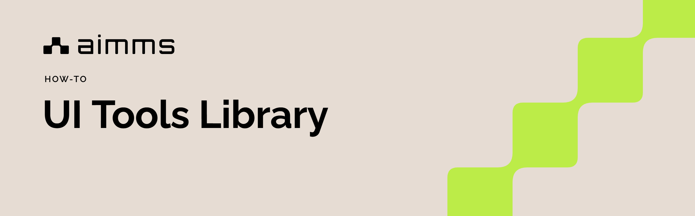

# aimms How-to: UI Tools Library

This repository contains the **minimal working example (MWE)** discussed in the following aimms How-to article:

**[Read the full article: UI Tools Library](https://how-to.aimms.com/Articles/717/717-ui-tools-library.html)**

## Getting started

1. **Download:** download the project as a [.zip file](https://github.com/aimms/717-ui-tools-test/archive/refs/heads/main.zip).
2. **Open:** launch the `.aimms` file.
3. **Explore:** open the **Model Explorer** (Ctrl+M) to examine the implementation logic described in the article.

## Support and feedback

This example is maintained by the **aimms User Support Team**.

- Found an issue? [Open an issue](https://github.com/aimms/717-ui-tools-test/issues).
- Questions? Reach out via the [aimms Community](https://community.aimms.com).

---

Maintained by the aimms User Support Team. We optimize the way you build optimization.
